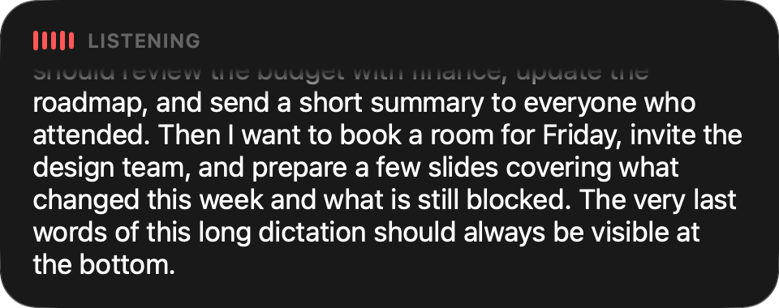
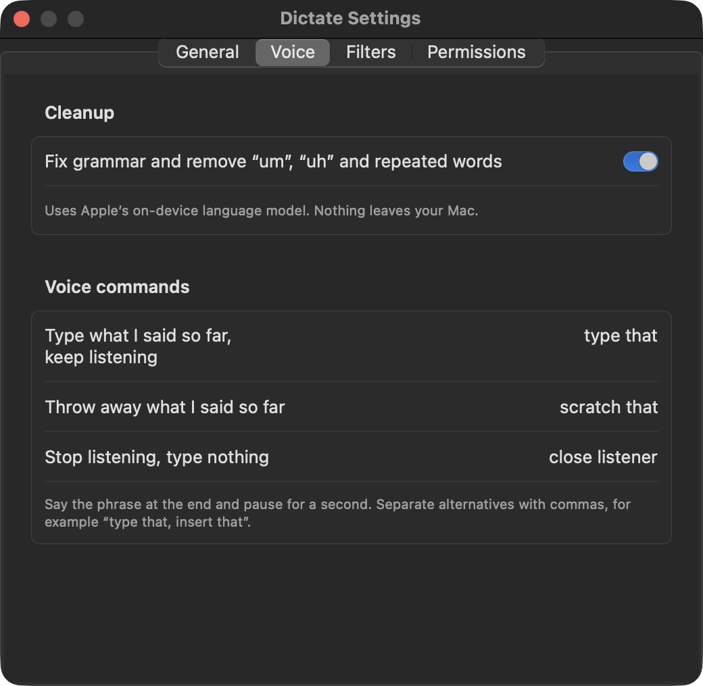
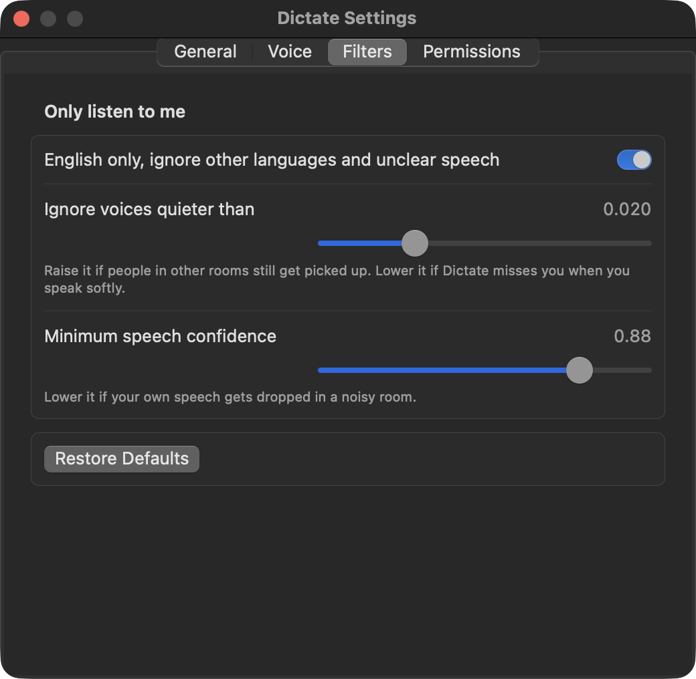

# Dictate

Press **Fn**, speak, and your words are typed wherever your cursor is. A native macOS menu-bar app that runs entirely on your Mac: fast on-device speech recognition, live text in a translucent floating window, automatic grammar cleanup, and hands-free voice commands.

<p align="center"></p>

## Features

- **Fn to dictate.** Press Fn to start, press again to stop (or switch to hold-to-talk). The text appears live in a Liquid Glass window, then is typed at your cursor in any app.
- **Fast and private.** [Parakeet Ultra](https://huggingface.co/matenek/parakeet-ultra) runs on the Neural Engine through Core ML. A short sentence transcribes in well under a tenth of a second. Nothing leaves your Mac.
- **Clean text.** Apple's on-device language model fixes grammar and removes "um", "uh" and stutters, keeping your own wording.
- **Voice commands** (say the phrase last, then pause for a second; all editable):

  | Say | What happens |
  |---|---|
  | **"type that"** | Types what you said so far, keeps listening for the next block |
  | **"scratch that"** | Throws away what you said so far, keeps listening |
  | **"close listener"** | Stops listening and types nothing |
- **Only listens to you.** A volume gate silences quiet, distant voices, and an English/confidence filter ignores other languages and unclear speech, so someone talking in the next room isn't transcribed.
- **Long dictation friendly.** The window shows everything you say and always scrolls to the newest words.
- **Settings window** for the trigger mode, sounds, launch at login, phrases, filters and permission status.

## Requirements

- Apple Silicon Mac, **macOS 14 or later**
- macOS 26 or later for the Liquid Glass look and the grammar-cleanup model. On macOS 14–25 the window uses a standard blur and cleanup falls back to simple filler-word removal.
- About 600 MB of disk space for the speech model

## Install

**From a release:** download `Dictate-<version>.zip` from the [Releases](../../releases) page, unzip, and move `Dictate.app` to `/Applications`. The app is not notarized, so on first launch macOS will refuse to open it. Right-click the app and choose **Open**, or run:

```sh
xattr -dr com.apple.quarantine /Applications/Dictate.app
```

**From source:**

```sh
git clone <this repository>
cd dictate
./scripts/setup-signing.sh   # one-time: lets macOS remember permissions across rebuilds
./build.sh                   # builds and installs /Applications/Dictate.app
```

Building needs Xcode (the macOS 26 SDK) and takes a couple of minutes the first time.

## First launch

1. Open Dictate. A microphone icon appears in the menu bar.
2. The first run **downloads the speech model** (about 600 MB) and shows an hourglass until it is ready.
3. Grant the three permissions in **System Settings → Privacy & Security** (Settings → Permissions in the app shows their status):
   - **Microphone**: to hear you
   - **Input Monitoring**: to detect the Fn key
   - **Accessibility**: to paste text at your cursor

   After granting Input Monitoring or Accessibility, quit and reopen Dictate once.
4. In **System Settings → Keyboard**, set "Press 🌐/fn key to" **Do Nothing** so macOS doesn't open the emoji picker.

Then click into any text field, press Fn, and talk.

<p align="center">
  
  
</p>

## How it works

```
Fn key ─► AudioCapture ─► VoiceGate ─► Parakeet Ultra (Core ML) ─► SpeechFilter ─► voice commands
(CGEventTap)  16 kHz mono    silences quiet     live preview every second       English + confidence      type / scratch / close
                             voices                                                                              │
                                                       cleaned by Apple's on-device LM ◄─────────────────────────┘
                                                                  │
                                                       TextInserter (paste at cursor, clipboard restored)
```

The code is split into `DictateCore` (pure, unit-tested logic) and `Dictate` (the app). See [CLAUDE.md](CLAUDE.md) for an architecture tour.

## Privacy

Audio is processed on your Mac and is never recorded to disk or sent anywhere. The only network access is the one-time model download. Pasting temporarily uses the clipboard; it is marked transient so clipboard managers skip it, and your previous clipboard is restored.

## Troubleshooting

| Problem | Fix |
|---|---|
| Fn does nothing | Grant Input Monitoring and Accessibility, then quit and reopen Dictate. Check Settings → Permissions. |
| Emoji picker opens on Fn | System Settings → Keyboard → "Press 🌐/fn key to" → Do Nothing |
| Permissions asked again after every rebuild | Run `./scripts/setup-signing.sh` once; builds are then signed with a stable identity |
| Text not typed | Make sure a text field has the cursor when you stop dictating |
| Your own speech is ignored | Settings → Filters: lower "Minimum speech confidence" or "Ignore voices quieter than" |
| Other people's speech is picked up | Settings → Filters: raise "Ignore voices quieter than" |

Logs are written to `~/.dictate/log.txt` and to Console.app (subsystem `local.dictate`).

## Contributing

See [CONTRIBUTING.md](CONTRIBUTING.md). Run the tests with `swift test`.

## Credits and licenses

- Dictate is released under the [MIT License](LICENSE).
- Speech runtime: [FluidAudio](https://github.com/FluidInference/FluidAudio) (Apache-2.0).
- Speech model: [Parakeet Ultra](https://huggingface.co/matenek/parakeet-ultra), a post-trained version of NVIDIA's Parakeet TDT 0.6B v3 (CC-BY-4.0). The model is downloaded separately and is not part of this repository.
